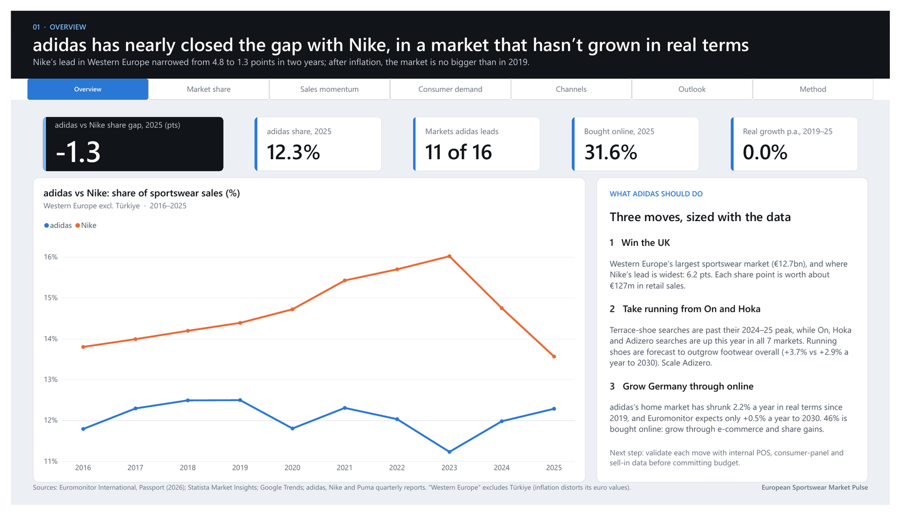
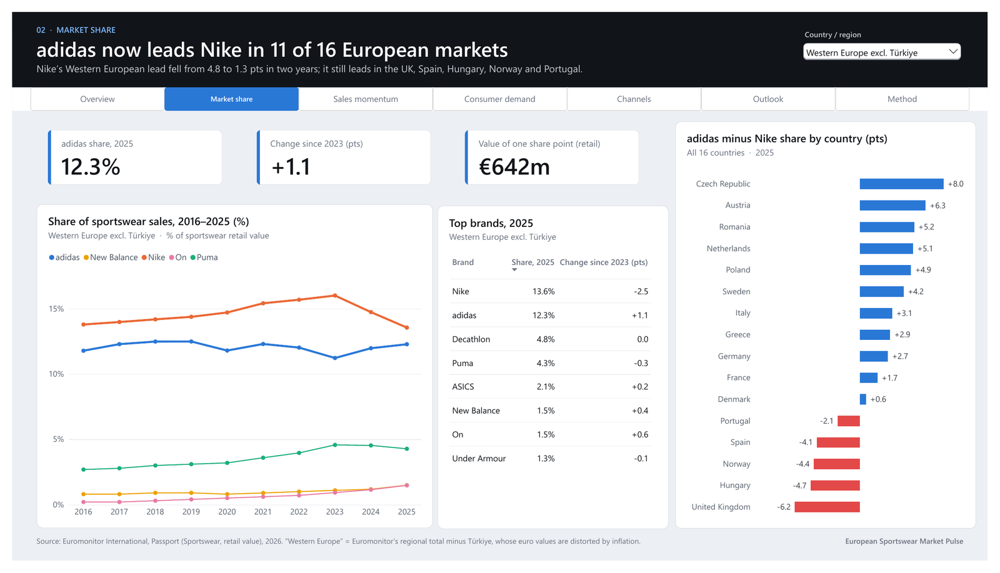
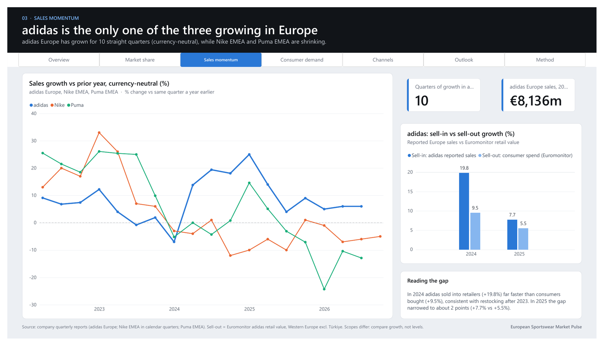
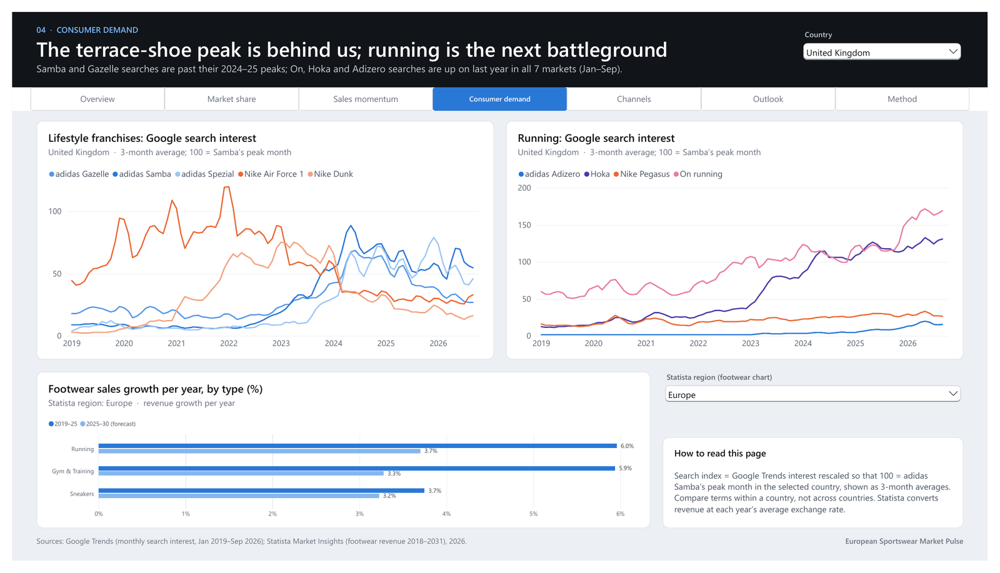
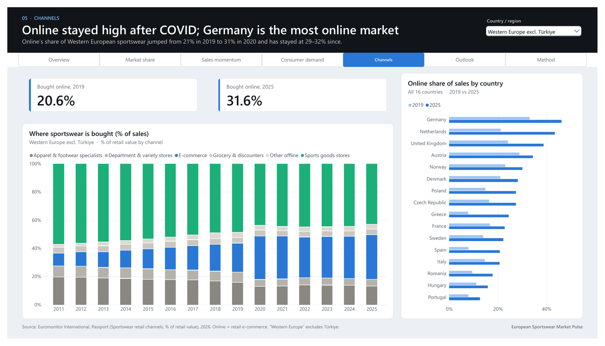
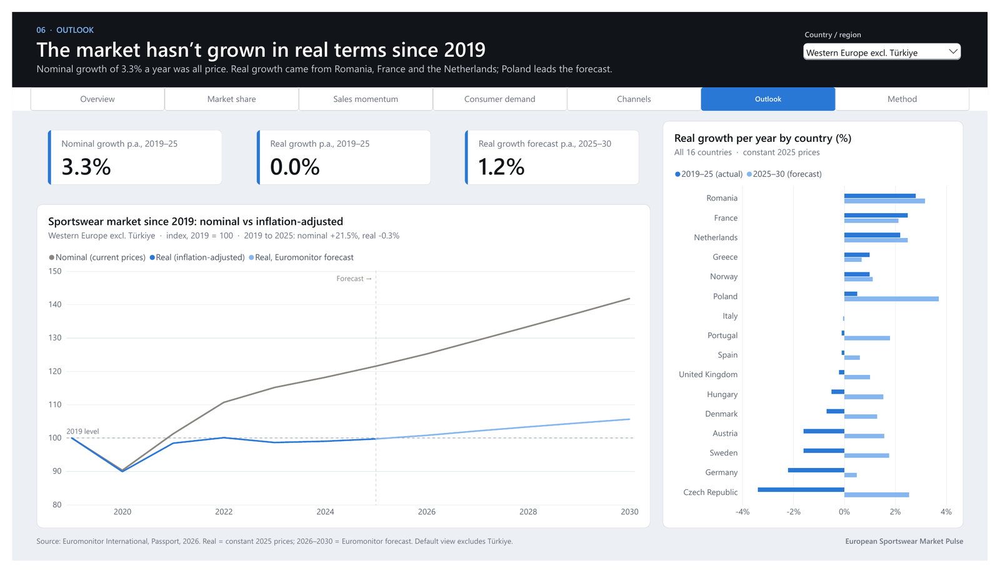
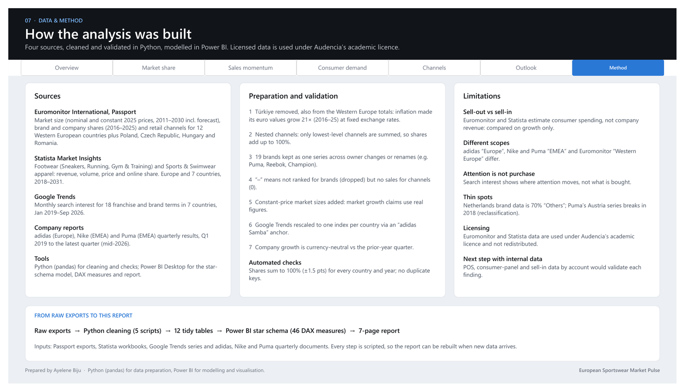

# European Sportswear Market Pulse

I built this Power BI report in October 2026 while applying for the Consumer, Marketplace and Sales Insights & Analytics internship at adidas. I wanted to answer one question with real market data: adidas has almost caught Nike in Europe, so where can it keep winning?

**[Read the full report (PDF, 7 pages)](report/European_Sportswear_Market_Pulse.pdf)**



## What I found

adidas is 1.3 share points behind Nike in Western Europe. In 2023 the gap was 4.8 points. adidas now leads in 11 of the 16 countries I looked at, up from 6 in 2023.

The market itself is not growing. Sportswear sales rose 3.3% a year from 2019 to 2025, but after inflation the growth is 0.0%. Every extra euro adidas makes has to come from a competitor. That is why the share gap matters more than the headline sales numbers.

adidas Europe has grown for 10 quarters in a row (currency-neutral). Nike EMEA and Puma EMEA are both shrinking.

The Samba and Gazelle wave is over. Searches peaked in 2024–25 in all 7 countries I tracked. On, Hoka and Adizero searches are higher this year than last year in every one of those countries, and Statista expects running shoes to grow 3.7% a year to 2030, against 2.9% for footwear overall.

About 30% of sportswear is now bought online, up from 21% before COVID. Germany is the outlier at 46%.

## What I would do

**Win the UK.** It is the biggest market in Western Europe (€12.7bn) and the place where Nike's lead is widest, 6.2 points. One share point there is worth about €127m in retail sales. I think this is the most important move in the report: Nike lost 4.3 share points in the UK since 2023, and adidas picked up only 1.1 of them.

**Take running from On and Hoka.** Running is where demand is moving, and Adizero searches are already rising.

**Grow Germany through online.** adidas's home market shrank 2.2% a year in real terms since 2019. Euromonitor expects only 0.5% a year to 2030. Growth there has to come from e-commerce and share.

All three need checking against internal data (POS, consumer panels, sell-in by account) before anyone spends money on them.

## The pages

| | |
|---|---|
|  |  |
|  |  |
|  |  |

## How I built it

The data comes from four places: Euromonitor Passport, Statista Market Insights, Google Trends, and the quarterly reports of adidas, Nike and Puma. I cleaned it in Python (pandas) and modelled it in Power BI with a star schema and [46 DAX measures](powerbi/measures.dax).

The hardest problem was Türkiye. At fixed exchange rates, Turkish inflation made its sportswear market grow 21 times in euros between 2016 and 2025. Left in, it made the Western European total grow faster than it really did, and it flattered adidas, which has 24% of the Turkish market. So I removed Türkiye everywhere, including from the regional totals.

Other fixes: Euromonitor's retail channels are nested, so adding them up counts sales two or three times. Some brands change owner during the period (Puma, Reebok, Champion), which splits them into two series. And every growth claim uses constant 2025 prices, not current prices.

The full method and its limits are in [docs/methodology.md](docs/methodology.md).

## Folders

```
report/   the PDF and page images
docs/     methodology
powerbi/  DAX measures
data/     list of the exports needed (no data)
```

## Data

Euromonitor and Statista data were accessed through Audencia's academic licence, so they are not in this repository. The report only shows aggregated figures with sources. [data/README.md](data/README.md) lists the exact exports I used.
